# CellMol_SexChrom_Helicoverpa_armigera

# Sex-Chromosome Dosage in *Helicoverpa armigera* (cotton bollworm) from WGS Read Depth

**Course:** Cell and Molecular Biology, individual practical exercise
**Student:** Isabella Tuble | **Section:** A
**Repository:** CellMol_SexChrom_Helicoverpa_armigera

## 1. Study question

Does the whole-genome sequencing (WGS) individual in SRR36217539 carry one or two copies of the Z chromosome relative to the autosomes, i.e. is it ZW-like (female) or ZZ-like (male)? The question is answered from the Z-to-autosome (Z:A) read-depth ratio.

## 2. Species and accessions

| Item | Value |
|---|---|
| Species | *Helicoverpa armigera* (cotton bollworm), Lepidoptera: Noctuidae |
| Sex system | ZW (females WZ, males ZZ) |
| Assembly | ASM3070526v1, RefSeq [GCF_030705265.1](https://www.ncbi.nlm.nih.gov/datasets/genome/GCF_030705265.1/) (GenBank GCA_030705265.1) |
| Assembly level | Chromosome (31 chromosomes + mitochondrion, 32 sequences, about 355 Mb) |
| Assembly isolate | CAAS_96S, whole pupa, Shandong, China, collected 1996 |
| Assembly BioSample | [SAMN18253696](https://www.ncbi.nlm.nih.gov/biosample/SAMN18253696) |
| Assembly BioProject | [PRJNA713413](https://www.ncbi.nlm.nih.gov/bioproject/PRJNA713413) |
| WGS run | [SRR36217539](https://www.ncbi.nlm.nih.gov/sra/SRX31253693) (experiment SRX31253693) |
| WGS BioSample | [SAMN53423462](https://www.ncbi.nlm.nih.gov/biosample/SAMN53423462) (sample MIC2x17-Trt_15) |
| WGS BioProject | PRJNA1119665, submitted by CSIRO |
| WGS library | Illumina NovaSeq 6000, WGS, GENOMIC, RANDOM, paired-end, 150 bp, 19,661,235 read pairs, 5.9 Gb |
| Same donor? | **No.** The reads come from a different individual (a lab line from Canberra, Australia, breed *conferta*; whole organism, collected 2022-05-10). |

**Evidence for a diploid ZW system.** *H. armigera* is a diploid moth with a ZW sex-determination system, with WZ females and ZZ males (see the W-specific marker paper and the Z dosage-compensation paper in the references). The assembly has no W sequence, which the lab permits.

**Identification of the Z chromosome.** The NCBI sequence report and the NC_087120.1 record call this sequence only "chromosome 1" (`/chromosome="1"`); they do not label it Z. The Z identity rests on the published literature, which designates chromosome 1 of this assembly as the Z chromosome (references 2 and 3). It is also the largest chromosome (18,757,413 bp), as expected for a Lepidopteran Z. 

## 3. Data retrieval and Galaxy workflow

Galaxy history (public): **https://usegalaxy.org/u/tuble_i_/h/sex-dosage-helicoverpa-armigera**

History name: `Sex_Dosage_Helicoverpa_armigera`

### Step 1. Reference genome
The RefSeq genomic FASTA and sequence report for GCF_030705265.1 were downloaded from NCBI Datasets (file source: RefSeq only). The FASTA was uploaded to Galaxy as type `fasta`. Galaxy reports 32 sequences, 359.7 MB. The chromosome identifiers (NC_087120.1 to NC_087150.1, plus NC_014668.1 for the mitochondrion) and their lengths were checked against the assembly report.

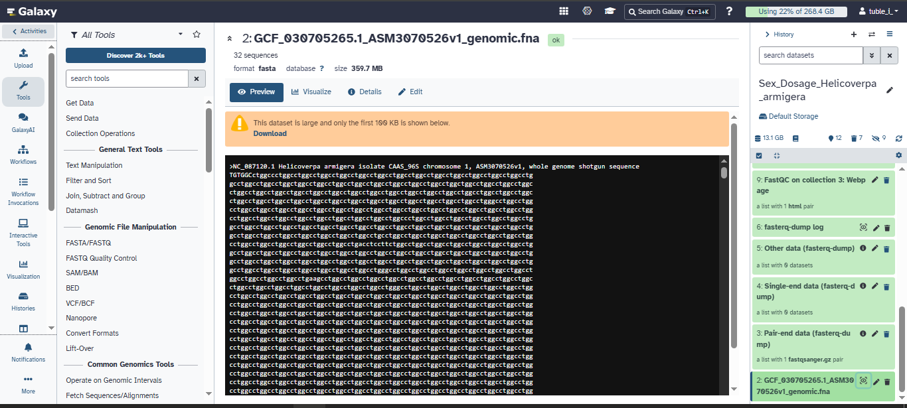

### Step 2. Import the WGS reads
Run SRR36217539 was imported with the Galaxy tool **Faster Download and Extract Reads in FASTQ**, giving a paired collection (forward and reverse, `fastqsanger.gz`). Only this single run (one individual) was analysed. No RNA-seq, RAD-seq or pooled data were used.

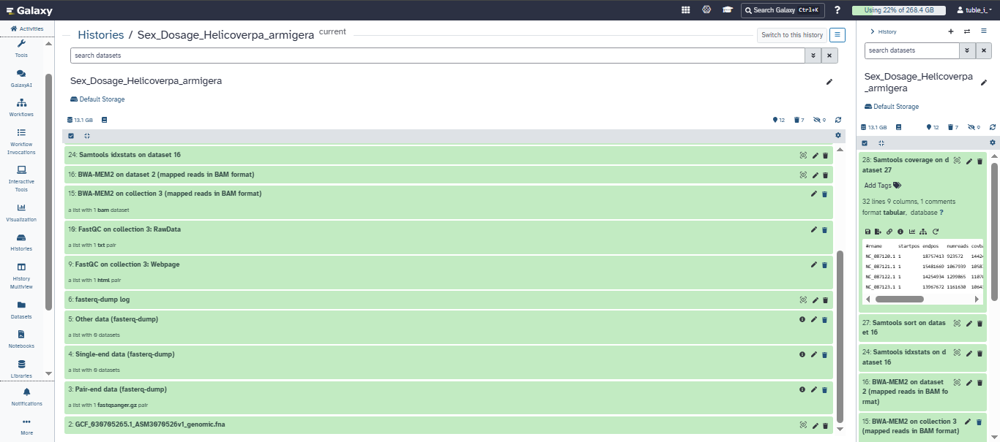
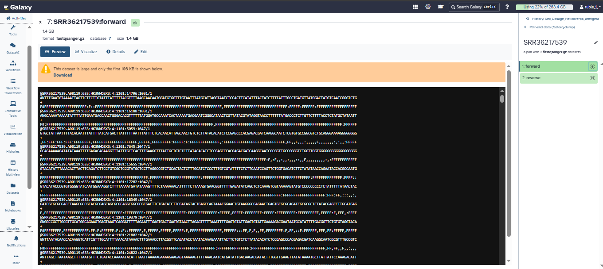

### Step 3. Quality control (FastQC)
FastQC was run on the paired collection. Both files contain 19,661,235 reads of 150 bp, with no reads flagged as poor quality and 37% GC. Per-base sequence quality, per-sequence quality scores, N content, length distribution, duplication levels and overrepresented sequences passed (green) for both files. FastQC flagged **Adapter Content**, **Per tile sequence quality** and **Per base sequence content** (red) and **Per sequence GC content** (orange) in both files. The per-base-content and GC flags are common for AT-rich insect genomes, and the per-tile flag is common on patterned NovaSeq flow cells. The adapter flag was considered more carefully. **Trimming decision:** no trimming was performed. BWA-MEM2 aligns reads locally and soft-clips any adapter sequence at read ends, the Z:A ratio compares chromosomes within the same library so adapter content affects all chromosomes alike, and 94.73% of reads mapped as primary alignments. 

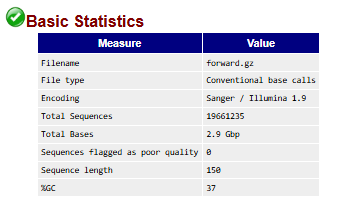
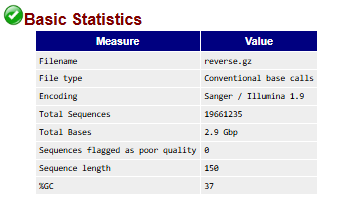
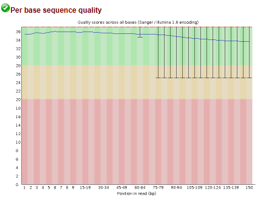
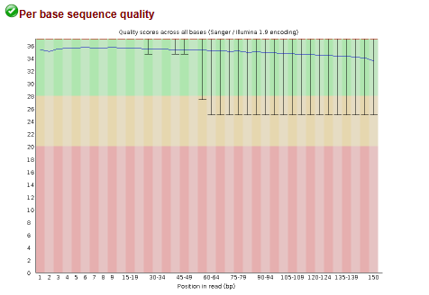
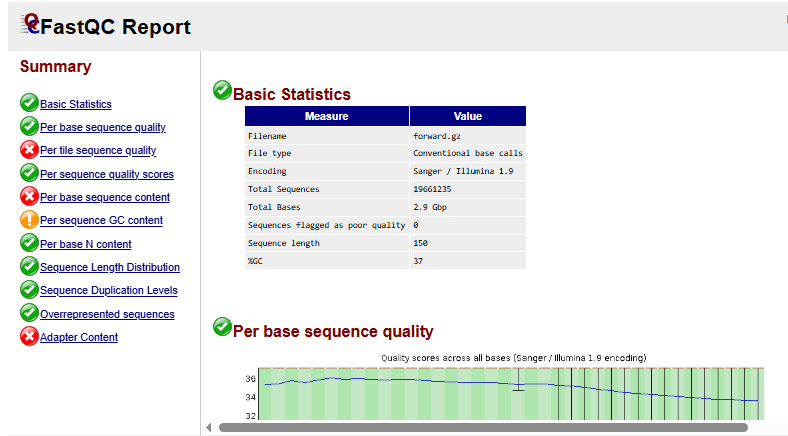
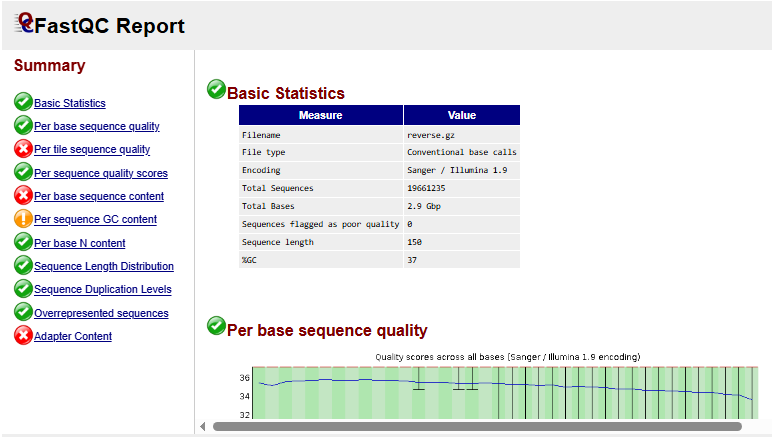

### Step 4. Read mapping
Reads were aligned with **BWA-MEM2** (Galaxy "Map with BWA-MEM2") to the same reference assembly, taken from the Galaxy history (reference: *use a genome from history and build index*). Paired collection input, Simple Illumina mode, output sorted by chromosomal coordinates.

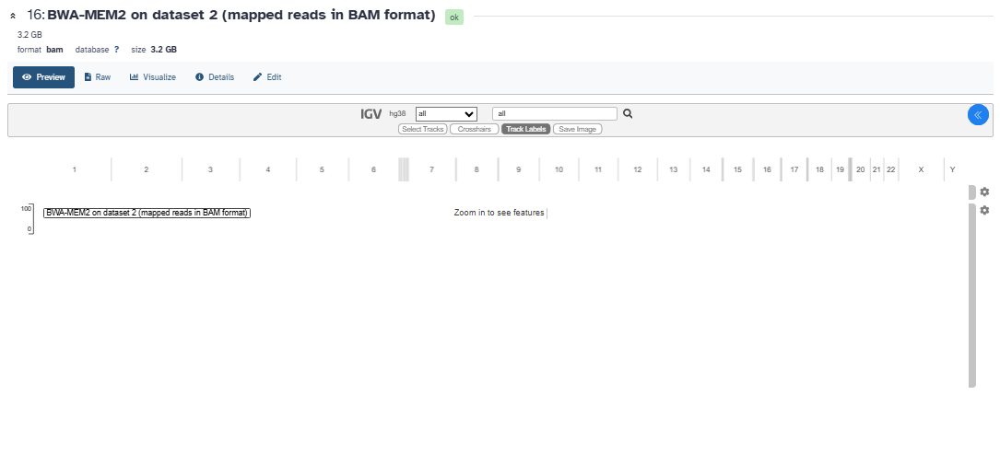

**Samtools flagstat:**

| Measure | Value |
|---|---|
| Reads in total (records) | 40,684,035 (39,322,470 primary + 1,361,565 supplementary) |
| Primary mapped | 37,249,077 (**94.73%**) |
| Properly paired | 34,326,294 (87.29%) |
| Singletons | 606,219 (1.54%) |

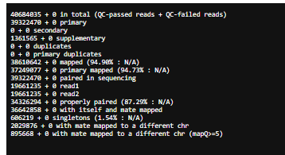

### Step 5. Per-chromosome coverage
**Samtools coverage** (Galaxy version 1.22+galaxy3) was run on **dataset 27, "Samtools sort on dataset 16"** (the coordinate-sorted BWA-MEM2 BAM), with **minimum mapping quality = 20**, **minimum base quality = 20**, minimum read length 0, no pooling, default flag exclusions (unmapped, non-primary, QC-fail and duplicate reads) and histogram = No (tabular output). The table has 32 data rows and was saved as `chromosome_coverage.tsv`. Note: the first Samtools coverage runs on the unsorted BAM inside the BWA-MEM2 collection returned empty tables, so the BAM was sorted with Samtools sort and coverage was rerun on the sorted file.

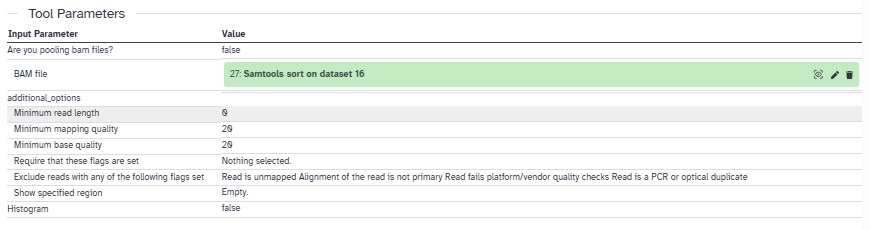
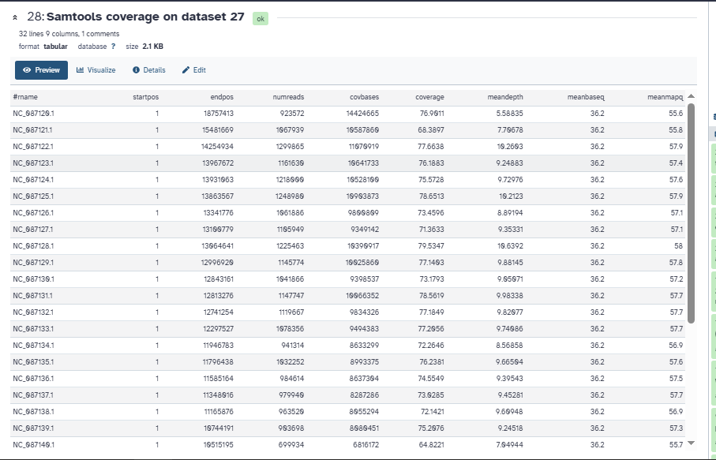

## 4. Chromosome groups (`chromosome_groups.csv`)

| Group | Sequences | Why |
|---|---|---|
| **Z** | NC_087120.1 (chromosome 1) | The single Z chromosome, identified from the literature (see section 2) and by being the largest chromosome. |
| **A** (30 autosomes) | NC_087121.1 to NC_087150.1 (chromosomes 2 to 31) | All remaining assembled nuclear chromosomes. The lab requires at least five. |
| Excluded | NC_014668.1 | Mitochondrial genome, never counted as an autosome. It has about 1,139x depth, as expected for organelle DNA. |
| W | none | The assembly contains no W sequence, so no W group was labelled. |

The `rname` values in `chromosome_groups.csv` are the RefSeq accessions and match `chromosome_coverage.tsv` exactly.

## 5. R analysis

The script below is the lab's `sex_depth_analysis.R` (base R, no packages). Put `chromosome_coverage.tsv` and `chromosome_groups.csv` in the same folder and run `Rscript sex_depth_analysis.R`.

```r
# Sex-chromosome dosage from whole-genome DNA read depth
# Input: Samtools coverage TSV + student chromosome labels

cov <- read.delim("chromosome_coverage.tsv", comment.char = "",
                  check.names = FALSE, stringsAsFactors = FALSE)
names(cov)[1] <- "rname"   # Accepts the '#rname' header
if (!"meandepth" %in% names(cov)) stop("Missing meandepth column")

key <- read.csv("chromosome_groups.csv", stringsAsFactors = FALSE)
if (!all(c("rname", "group") %in% names(key))) stop("Bad key columns")
key$rname <- trimws(key$rname)
key$group <- toupper(trimws(key$group))
if (anyDuplicated(key$rname)) stop("Repeated rname in key file")
if (!all(key$group %in% c("A", "X", "Y", "Z", "W")))
  stop("Use only A, X, Y, Z or W in the group column")

x <- merge(key, cov[, c("rname", "meandepth")],
           by = "rname", all.x = TRUE, sort = FALSE)
x$meandepth <- suppressWarnings(as.numeric(x$meandepth))
if (anyNA(x$meandepth)) stop("Missing depths: check rname matches")
if (any(x$meandepth < 0)) stop("Negative depth is not valid")
if (sum(x$group == "A") < 5) stop("Label at least 5 autosomes")
if ("X" %in% x$group && "Z" %in% x$group)
  stop("Choose either an XY or a ZW species, not both")

if (sum(x$group == "X") == 1 && !any(x$group == "Z")) {
  target <- "X"
  one_copy <- "XY-like"
  two_copies <- "XX-like"
} else if (sum(x$group == "Z") == 1 && !any(x$group == "X")) {
  target <- "Z"
  one_copy <- "ZW-like"
  two_copies <- "ZZ-like"
} else stop("Label exactly one X or exactly one Z chromosome")

A <- median(x$meandepth[x$group == "A"])
if (!is.finite(A) || A <= 0) stop("No usable autosomal coverage")
x$relative_depth <- x$meandepth / A

ratio <- x$relative_depth[x$group == target]
call <- if (ratio >= 0.80) two_copies else if (ratio <= 0.65)
  one_copy else "Ambiguous"
if (A < 1) call <- "Inconclusive: very low autosomal depth"

# Additional Y or W evidence can support, but not prove, a call
partner <- if (target == "X") "Y" else "W"
partner_ratio <- if (partner %in% x$group)
  x$relative_depth[x$group == partner][1] else NA_real_

# Export results and a simple, reproducible figure
dir.create("results", showWarnings = FALSE)
write.csv(x, "results/chromosome_relative_depth.csv", row.names = FALSE)

png("results/chromosome_depth.png", width = 1000, height = 580)
par(mar = c(8, 4, 3, 1))
barplot(x$relative_depth, names.arg = x$rname, las = 2,
        ylab = "Depth relative to median autosome",
        main = "Autosomal and sex-chromosome depth", cex.names = 0.75)
abline(h = c(0.5, 1.0), lty = 2)
dev.off()

summary <- c(paste("Median autosome depth:", round(A, 3)),
             paste(target, "/ A ratio:", round(ratio, 3)),
             paste(partner, "/ A ratio:", round(partner_ratio, 3)),
             paste("Dosage interpretation:", call),
             "Compare with BioSample sex and discuss limitations.")
writeLines(summary, "results/sex_inference.txt")
cat(paste(summary, collapse = "\n"), "\n")
```

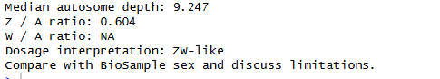

### Input coverage data and relative depth

| Sequence (rname) | Group | Length (bp) | Mean depth | Relative depth (÷ median A) |
|---|---|---:|---:|---:|
| NC_087120.1 | Z | 18,757,413 | 5.588 | 0.604 |
| NC_087121.1 | A | 15,481,669 | 7.707 | 0.833 |
| NC_087122.1 | A | 14,254,934 | 10.260 | 1.110 |
| NC_087123.1 | A | 13,967,672 | 9.249 | 1.000 |
| NC_087124.1 | A | 13,931,063 | 9.730 | 1.052 |
| NC_087125.1 | A | 13,863,567 | 10.212 | 1.104 |
| NC_087126.1 | A | 13,341,776 | 8.892 | 0.962 |
| NC_087127.1 | A | 13,100,779 | 9.353 | 1.011 |
| NC_087128.1 | A | 13,064,641 | 10.639 | 1.151 |
| NC_087129.1 | A | 12,996,920 | 9.881 | 1.069 |
| NC_087130.1 | A | 12,843,161 | 9.051 | 0.979 |
| NC_087131.1 | A | 12,813,276 | 9.983 | 1.080 |
| NC_087132.1 | A | 12,741,254 | 9.821 | 1.062 |
| NC_087133.1 | A | 12,297,527 | 9.741 | 1.053 |
| NC_087134.1 | A | 11,946,783 | 8.569 | 0.927 |
| NC_087135.1 | A | 11,796,438 | 9.665 | 1.045 |
| NC_087136.1 | A | 11,585,164 | 9.395 | 1.016 |
| NC_087137.1 | A | 11,348,016 | 9.453 | 1.022 |
| NC_087138.1 | A | 11,165,876 | 9.609 | 1.039 |
| NC_087139.1 | A | 10,744,191 | 9.245 | 1.000 |
| NC_087140.1 | A | 10,515,195 | 7.049 | 0.762 |
| NC_087141.1 | A | 10,338,994 | 8.778 | 0.949 |
| NC_087142.1 | A | 10,328,060 | 9.347 | 1.011 |
| NC_087143.1 | A | 10,268,548 | 6.419 | 0.694 |
| NC_087144.1 | A | 9,527,143 | 8.153 | 0.882 |
| NC_087145.1 | A | 8,306,785 | 8.563 | 0.926 |
| NC_087146.1 | A | 8,250,784 | 5.576 | 0.603 |
| NC_087147.1 | A | 8,036,318 | 8.321 | 0.900 |
| NC_087148.1 | A | 6,256,087 | 6.761 | 0.731 |
| NC_087149.1 | A | 5,805,717 | 7.564 | 0.818 |
| NC_087150.1 | A | 5,556,251 | 6.957 | 0.752 |
| NC_014668.1 | excluded (mitochondrion) | 15,347 | 1138.970 | n/a |

### Results (`results/` folder)

- `results/chromosome_relative_depth.csv`: relative depth for each labelled sequence
- `results/chromosome_depth.png`: bar plot of relative depth
- `results/sex_inference.txt`: summary of the dosage call

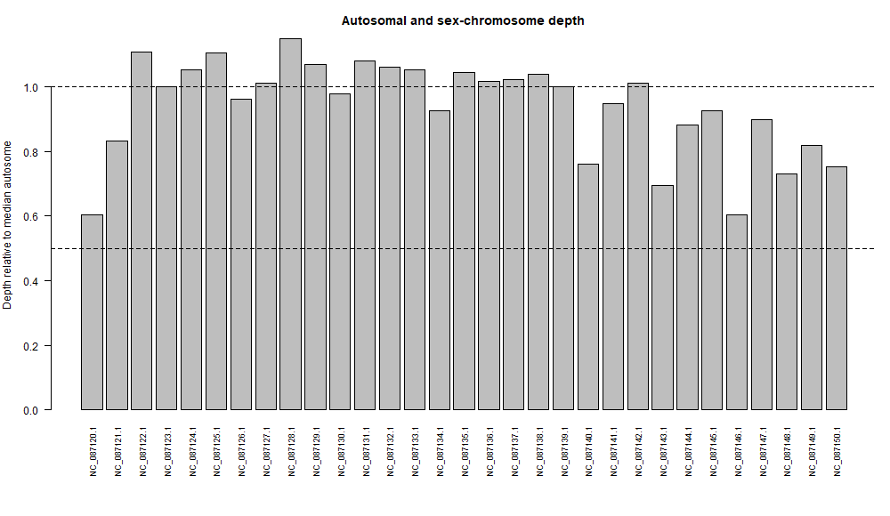

| Measure | Value |
|---|---|
| Median autosome depth | **9.247x** |
| Z mean depth | 5.588x |
| **Z:A ratio** | **0.604** |
| W:A ratio | NA (no W in the assembly) |
| Dosage interpretation | **ZW-like** |

## 6. Interpretation

The Z:A ratio is 0.604. In an ordinary ZZ individual the ratio should be near 1.0, and in a ZW individual near 0.5. The classroom script classes ratios of 0.65 or below as one-copy ("ZW-like") and 0.80 or above as two-copy ("ZZ-like"). The value 0.604 is below the 0.65 cutoff and is far from a two-copy value, so the sequenced individual is called **ZW-like, most consistent with a female**. In addition, the Z has the second-lowest depth of all 31 chromosomes: only one of the 30 autosomes (NC_087146.1, 0.603) has a relative depth at or below 0.65, whereas a ZZ individual would be expected to show Z depth within the normal autosomal range. The cutoffs are teaching guidelines, not diagnostic thresholds, and the ratio sits closer to the ambiguous zone than to a clean 0.5 (see limitations).

## 7. Answers to the six questions

**1. What species did you choose, and what evidence supports a diploid ZW system?**
*Helicoverpa armigera*, the cotton bollworm. It is a diploid moth. Published work describes a WZ/ZZ sex-determination system (a W-specific gene for sex identification, and Z-chromosome dosage-compensation studies). The RefSeq assembly has an assembled Z chromosome (chromosome 1, NC_087120.1), identified in the literature.

**2. What are your assembly accession, WGS run, and both BioSample accessions? Are the donors the same?**
Assembly GCF_030705265.1 (ASM3070526v1), assembly BioSample SAMN18253696; WGS run SRR36217539, WGS BioSample SAMN53423462. The donors are **not** the same: the assembly donor is the CAAS_96S pupa from China, and the WGS donor is a *conferta* lab-line individual from Canberra, Australia. The result therefore describes the WGS individual only.

**3. Which sequences were used as autosomes and as X or Z? How did you verify their identities?**
Z: NC_087120.1. Autosomes: NC_087121.1 to NC_087150.1 (30 sequences). The mitochondrion (NC_014668.1) was excluded. Identities were checked against the NCBI assembly report (all 31 chromosomes plus the mitochondrion, with matching lengths) and the NC_087120.1 GenBank record. The NCBI record labels the sequence only as chromosome 1, so its identity as the Z chromosome comes from the published literature and was approved by the instructor.

**4. What are the median autosomal depth, X:A or Z:A ratio, and inferred sex-chromosome complement?**
Median autosomal depth 9.247x; Z:A = 0.604; inferred complement ZW-like (one Z copy per diploid genome).

**5. Does your result agree with the recorded sex of the WGS donor, if reported? Explain any discrepancy or uncertainty.**
The WGS BioSample (SAMN53423462) lists no sex (it records breed, isolation source, collection date, location, tissue "whole organism" and a lab identifier), so there is nothing to compare against. The call rests on sequence evidence alone and is not validated by metadata. The assembly donor's sex is also not recorded, and the donors differ, so it would not be a valid comparison anyway.

**6. Why is a chromosome-level assembly alone insufficient for a reliable read-depth sex inference?**
An assembly has one haploid copy of each chromosome and says nothing about how many copies the sequenced individual carries. Copy number is only revealed by how many reads map to a chromosome relative to the autosomes. The assembly also may not identify the sex chromosomes, may lack the W or Y, and was built from a different individual who may be either sex. Dosage must therefore be measured from reads from the individual in question.

## 8. Limitations

- **Z identity is literature-based.** The NCBI record calls it chromosome 1, not Z.
- **Different donors and subspecies.** The reads are from *H. a. conferta* (Canberra lab line) mapped to a reference from China, which can lower mapping rates and bias depth in divergent or repetitive regions. The primary mapping rate was still high (94.73%).
- **Depth varies among autosomes.** Relative depths range from about 0.60 to 1.15. Small chromosomes such as NC_087146.1 (0.603) and NC_087143.1 (0.694) have depth as low as the Z, so repeats and mapping bias may account for some of the Z deficit. The ratio of 0.604 is also not a clean 0.5.
- **FastQC flags.** Adapter Content, Per tile sequence quality and Per base sequence content were flagged red, and reads were not trimmed (see Step 3). Residual adapter sequence could lower mapping slightly but is not expected to change the Z:A ratio, because it affects all chromosomes alike.
- **Moderate depth.** About 17x raw coverage; after the mapping-quality and base-quality filters the median autosomal mean depth is 9.2x with about 70 to 77% of bases covered.
- **No W sequence.** The W:A ratio could not be calculated, so there is no supporting W evidence.
- **Pseudoautosomal regions and unusual karyotypes** were not investigated and could affect ratios.
- **No sex metadata** exists for validation.
- **Teaching cutoffs.** The 0.65 and 0.80 thresholds are classroom guidelines, not diagnostic.

## 9. References

1. NCBI Datasets, *Helicoverpa armigera* assembly GCF_030705265.1 (ASM3070526v1), https://www.ncbi.nlm.nih.gov/datasets/genome/GCF_030705265.1/
2. Jin M, North HL, Peng Y, et al. Adaptive evolution to the natural and anthropogenic environment in a global invasive crop pest, the cotton bollworm. *The Innovation* 4(4):100454 (2023). PMID 37388193. (Source of the CAAS_96S assembly.)
3. Sex-chromosome (chromosome 1 / Z) designation in *H. armigera*: Cell Reports diapause supergene paper, https://www.sciencedirect.com/science/article/pii/S2211124724012907 ; and the flubendiamide-resistance genetic architecture paper, PLOS ONE, https://journals.plos.org/plosone/article?id=10.1371/journal.pone.0318154
4. Characterization of the first W-specific protein-coding gene for sex identification in *Helicoverpa armigera*, https://pmc.ncbi.nlm.nih.gov/articles/PMC7317607
5. Transcriptomic and proteomic elucidation of Z chromosome dosage compensation in *Helicoverpa armigera*. Insect Molecular Biology (2024), https://pubmed.ncbi.nlm.nih.gov/38949741
6. NCBI SRA, run SRR36217539 / experiment SRX31253693, https://www.ncbi.nlm.nih.gov/sra/SRX31253693
7. Galaxy: usegalaxy.org; Samtools coverage, https://www.htslib.org/doc/samtools-coverage.html ; FastQC; BWA-MEM2 (Vasimuddin et al. 2019).
8. Sex-chromosome coverage review, https://pmc.ncbi.nlm.nih.gov/articles/PMC6900093/

## 10. Repository contents

```
README.md
sex_depth_analysis.R
chromosome_coverage.tsv
chromosome_groups.csv
results/
    chromosome_relative_depth.csv
    chromosome_depth.png
    sex_inference.txt
Screenshots/
    01_ ... 09_ (workflow screenshots)
```
Large FASTQ, FASTA and BAM files are not included.
